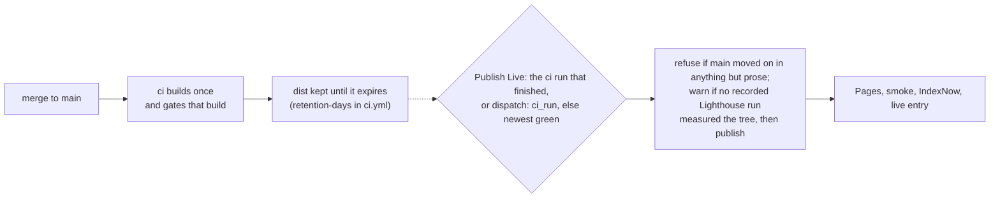

# Publish the build

Use this to put a built `dist/` on Cloudflare Pages, and to find out why a deploy will not run before you
attempt one. The site is static: nothing is built on Cloudflare, and the artefact the gates measured is the
artefact uploaded; a build assembled a second time is not the one the Calibration Gate passed.

## Credentials

`site/.env.example` names every variable and its token scope. Copy it to a file named .env beside
it, which git ignores, and fill it in. Three variables are required:

| Variable                   | What it is                                                                  |
| -------------------------- | --------------------------------------------------------------------------- |
| `CLOUDFLARE_API_TOKEN`     | Custom token: Account → Cloudflare Pages → Edit, User → User Details → Read |
| `CLOUDFLARE_ACCOUNT_ID`    | The account the Pages project lives in                                      |
| `CLOUDFLARE_PAGES_PROJECT` | The project serving `<name>.pages.dev` (L16)                                |

Add `Zone → DNS → Edit` only if the apex is ever attached from a script; today the owner does it by hand (row G35).

Never put a token on a command line or in a commit. `npm run deploy:check` and the deploy scripts read that
file through Node's `--env-file-if-exists`, so no secret reaches your shell history. Their rules live in `site/scripts/deploy.mjs`.

## Before the first deploy

```bash
npm run deploy:check
```

It answers four questions in order, and stops at the first that fails: is every variable set, does the
token authenticate, can it read Pages, and does the project exist. A missing scope comes back as a
sentence naming it, not a failed upload. The check prints six characters of the account id, never the token.

## Deploying

```bash
npm run build          # the only build that may be published
npm run deploy:preview # a preview URL, unique to this upload
npm run deploy         # production
```

Both refuse a `dist/` whose routes differ from `audits/routes.json`, naming what was added or dropped.
Run the gates, then `npm run assets:routes` if the change is intended. The writer commits that ledger
with every route it adds, so a refusal on its branch means a merge or a hand edit moved the routes.

Production, never a preview, also warns of a tree no recorded Lighthouse run measured and publishes it anyway: the
line never stops for a measurement only a person can take. `::warning::DEPLOY` names the entry whose debt is open and
the command that clears it; measure the tree and commit `audits/lighthouse-green.json`. No flag silences the warning.

## What CI does

`deploy-preview` in `ci.yml` deploys every pull request to `pr-<number>`, smokes it and comments the URL.
Production is **Publish Live**, run by itself after a green `ci` push run on `main` or by dispatch: `run-publish-target.mjs` picks the run, `publish-target.mjs` holds the rules.



Only prose never blocks — a workflow or test commit does, measured on 2026-10-17 when a press refused on
`.github/workflows/publish-live.yml` alone. The refusal applies to a named run too, so `ci_run` re-publishes rather
than undoes. Reverting means reverting on `main`, gating and publishing it (row G42 in `docs/plan/reference/known-gaps.md`).

## After deploying

```bash
npm run smoke:prod <url>
```

17 live requests against any origin — status, headers, the per-route verdict — plus 2 `www` 301 checks
on the apex. Only a live response can confirm the headers of `dist/_headers`; a green local gate cannot.

**Publish Live** then runs `node scripts/live-entry.mjs --dist dist --state .live-entries.json`.
`scripts/live-announce.mjs` asks `site.site`, not `pages.dev`, for the page of every entry no message announced
(`scripts/live-probe.mjs`: 8 requests, 140 s of waiting) and posts the month, cost, buyer prompt, links and check
time. A page that never answers is a warning message and a `::warning::`; the step exits 0 and the next publish
asks again. A tree no run measured adds a section to the same message. Cache steps keep the state; with none, only the last 48 hours are announced.
