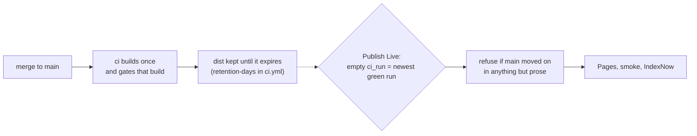

# Publish the build

Use this to put a built `dist/` on Cloudflare Pages, and to find out why a deploy will not run
before you attempt one. The site is static: nothing is built on Cloudflare, and the artefact the
gates measured is the artefact that is uploaded. That equality is the whole point — a build
assembled a second time on someone else's machine is not the build the Calibration Gate passed.

## Credentials

`site/.env.example` names every variable and the exact token scope beside it. Copy it to a file
named .env in the same directory, which git ignores, and fill it in. Three variables are required:

| Variable                   | What it is                                                                  |
| -------------------------- | --------------------------------------------------------------------------- |
| `CLOUDFLARE_API_TOKEN`     | Custom token: Account → Cloudflare Pages → Edit, User → User Details → Read |
| `CLOUDFLARE_ACCOUNT_ID`    | The account the Pages project lives in                                      |
| `CLOUDFLARE_PAGES_PROJECT` | The project serving `meshin.pages.dev` (L16)                                |

Add `Zone → DNS → Edit` only if the apex is ever attached from a script. It is not today: the
owner attaches it by hand, which row G35 records.

Never put a token on a command line or in a commit. `npm run deploy:check` and the deploy scripts
read that file through Node's `--env-file-if-exists`, so no secret reaches your shell history.
The rules they apply — which variables are required, the wrangler arguments, and the route-ledger
refusal below — live in `site/scripts/deploy.mjs` and are unit-tested without a network.

## Before the first deploy

```bash
npm run deploy:check
```

It answers four questions in order, and stops at the first that fails: is every variable set, does
the token authenticate, can it read Pages, and does the project already exist. A missing scope
comes back as a sentence naming the scope, not as a failed upload. The check prints only the first
six characters of the account id and never prints the token.

## Deploying

```bash
npm run build          # the only build that may be published
npm run deploy:preview # a preview URL, unique to this upload
npm run deploy         # production
```

Both refuse a `dist/` whose routes differ from `audits/routes.json`, naming what was added or
dropped. That ledger is what `npm run gate:routes` compares against, so the refusal means the
gates have not seen this build. Run them, then `npm run assets:routes` if the route change is
intended.

## What CI does

Neither path builds again: a second build is a different artefact the Calibration Gate never
measured. `deploy-preview` in `ci.yml` deploys every pull request to `pr-<number>`, smokes it and
comments the URL. Production is **Publish Live**, pressed by hand: `scripts/run-publish-target.mjs`
picks the run, `scripts/publish-target.mjs` holds the rules.



Only prose never blocks — a workflow or test commit does, measured on 2026-10-17 when a press
refused on `.github/workflows/publish-live.yml` alone. The refusal applies to a named run too, so
`ci_run` re-publishes rather than undoes. Reverting a release means reverting on `main`, gating
that and publishing it; row G42 in `docs/plan/reference/known-gaps.md` records the cost.

## After deploying

```bash
npm run smoke:prod <url>
```

18 live requests against any origin — status, headers, the per-route verdict — plus 2 `www` 301
checks when that origin is the apex. A green local gate says nothing about what Cloudflare serves:
the headers come from `dist/_headers`, which only the live response can confirm.
